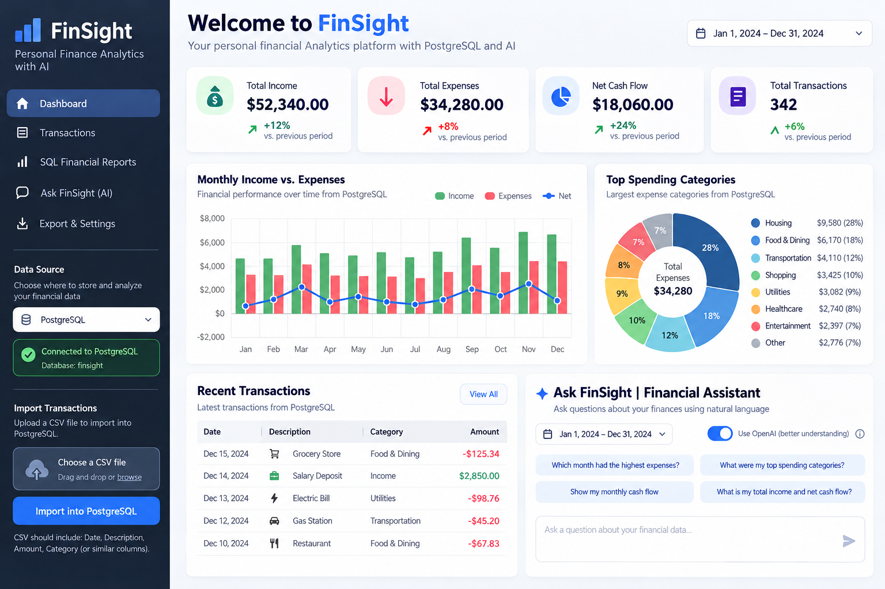

<div align="center">


# FinSight 📊

### Financial analytics, PostgreSQL reporting & AI-assisted insights

**Python · Streamlit · PostgreSQL · SQL · Plotly · pandas · OpenAI API**

[](https://www.python.org/) [](https://streamlit.io/) [](https://www.postgresql.org/)

</div>

## ✨ Overview

**FinSight** is a financial analytics portfolio application for exploring synthetic transaction data. It combines a Streamlit dashboard with PostgreSQL-backed reporting, interactive Plotly visualizations, and an optional OpenAI-powered question classifier. This is a **portfolio prototype**, not a banking application.

## 🚀 Features

- **Dashboard:** Income, expenses, net cash flow, transaction counts, monthly trends, and spending by category.
- **Date range:** Select a reporting period to filter analytics.
- **Transaction explorer:** Search by description/category, filter categories, and export results.
- **SQL reports:** Monthly cash flow, category spending, and overall financial summaries computed in PostgreSQL.
- **Financial assistant:** Ask supported reporting questions. Optional OpenAI intent classification maps questions to a restricted set of read-only SQL report functions; no transaction rows are sent to OpenAI.
- **CSV import/export:** Validate and import transactions; download filtered records and reports.

## 🖥️ Dashboard preview

Add a screenshot from your running application at `assets/dashboard.png` and uncomment the following line:

<!--  -->

## 🧰 Tech stack

<p>

</p>

**Interface:** Streamlit · **Data processing:** pandas · **Visualization:** Plotly · **Database:** PostgreSQL via psycopg · **AI integration:** OpenAI API (optional)

## ⚡ Quick start — CSV demo (no database needed)

Requires Python 3.10 or later.

```bash
git clone https://github.com/khaydieramos/finsight.git
cd finsight
python3 -m venv .venv
source .venv/bin/activate
python -m pip install -r requirements.txt
python -m streamlit run app.py
```

In the sidebar, choose **CSV prototype** as the data source. The included `data/sample_transactions.csv` contains **synthetic example transactions**. The dashboard, transaction explorer, date filtering, and CSV export work in this mode.

## 🗄️ PostgreSQL setup

Install and start PostgreSQL locally, then create a database named `finsight` (for example, `createdb finsight` if your local PostgreSQL tools are configured).

On macOS/Linux, in the same terminal session:

```bash
export DATABASE_URL="postgresql:///finsight"
python -m streamlit run app.py
```

Choose **PostgreSQL** in the sidebar, then click **Import CSV into PostgreSQL** to load the bundled synthetic transactions. FinSight automatically creates the `transactions` table if needed and skips exact duplicate imports.

If your PostgreSQL setup uses a username/password or different host, set `DATABASE_URL` to your own valid PostgreSQL connection string instead. Never commit credentials.

### Optional OpenAI question classification

```bash
export OPENAI_API_KEY="your-private-api-key"
```

In PostgreSQL mode, enable **Use OpenAI to interpret my question**. Without this toggle, the financial assistant uses local deterministic question routing; the assistant still requires PostgreSQL. API usage may incur costs.

## 📂 Project structure

```text
finsight/
├── app.py                     # Streamlit interface and visualizations
├── assistant.py               # Safe question routing and optional OpenAI integration
├── data_utils.py              # CSV validation and data aggregation
├── db.py                      # PostgreSQL schema, import and retrieval
├── reporting.py               # Parameterized, read-only SQL reports
├── data/
│   └── sample_transactions.csv # Synthetic demo transactions
├── finsight_icon.png          # Application icon
├── requirements.txt
├── .env.example               # Configuration template (not real secrets)
├── .gitignore
└── README.md
```

## 🔒 Data and safety notes

- Sample transactions are fabricated and are not personal financial records.
- Do **not** upload private banking data or commit API keys, `.env` files, or database passwords.
- The OpenAI integration classifies the **question text** into approved operations; PostgreSQL executes the reports.
- The application is a demonstration, not a production-grade financial or security system.

## 👩‍💻 Author

**Khaydie Ramos** · Computer Science, Fordham University  
[GitHub](https://github.com/khaydieramos) · [Email](mailto:kjr6@fordham.edu)
